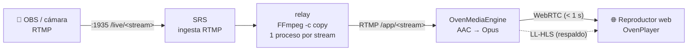

<h1 align="center">📡 streaming-rtmp-webrtc-stack</h1>

<p align="center">
  Pipeline de video en vivo de <b>baja latencia</b>: de OBS al navegador en menos de un segundo,<br/>
  levantado con un solo comando y probado de punta a punta en cada push.
</p>

<p align="center">
  <a href="https://github.com/osvaldo96-reyes/streaming-rtmp-webrtc-stack/actions/workflows/ci.yml"></a>
  
  
  
  
</p>

---

Esta es una versión **abierta y genérica** de la arquitectura que diseñé y opero en producción para transmitir en vivo varias salas de audiencias. La original es privada; aquí está el mismo diseño, listo para clonar y probar.

## Arquitectura



| Servicio | Imagen | Función |
|---|---|---|
| `srs` | `ossrs/srs:6.0.195` | Recibe RTMP desde OBS. Punto de entrada único y estable para las fuentes. |
| `relay` | build local (Alpine + FFmpeg) | Reenvía cada stream a OME **sin recodificar** y se reconecta solo si la fuente se cae. |
| `ome` | `airensoft/ovenmediaengine:v0.20.5` | Convierte audio a Opus y publica por **WebRTC** y **LL-HLS**. |
| `player` | `nginx:1.28-alpine` | Página con OvenPlayer: WebRTC con caída automática a LL-HLS. |

## Inicio rápido

```bash
git clone https://github.com/osvaldo96-reyes/streaming-rtmp-webrtc-stack.git
cd streaming-rtmp-webrtc-stack
cp .env.example .env        # opcional: IP del servidor y lista de streams
make up                     # o: docker compose up -d --build
make test-stream            # publica barras de color en el stream "demo"
```

Abre **http://localhost:8088** y verás la señal de prueba en vivo.

### Transmitir desde OBS

| Campo en OBS → Ajustes → Emisión | Valor |
|---|---|
| Servicio | Personalizado |
| Servidor | `rtmp://<IP-del-servidor>:1935/live` |
| Clave de retransmisión | `demo` (o cualquier nombre de `STREAMS`) |

Para baja latencia en OBS usa **x264, tune `zerolatency`, intervalo de keyframe 1–2 s y sin B-frames**.

## Puertos

| Puerto | Uso |
|---|---|
| 1935/tcp | RTMP de entrada (SRS) |
| 1985/tcp | API de SRS: `curl localhost:1985/api/v1/streams/` |
| 3333/tcp | Señalización WebRTC y LL-HLS (OME) |
| 3478/tcp | WebRTC sobre TCP, para redes que bloquean UDP |
| 10000-10004/udp | Medios WebRTC |
| 8088/tcp | Reproductor web |

## CI/CD

Cada push corre en GitHub Actions ([`ci.yml`](.github/workflows/ci.yml)):

| Job | Qué valida |
|---|---|
| **Lint** | `hadolint` (Dockerfile), `shellcheck` (scripts) y `docker compose config` |
| **Seguridad** | Escaneo de la imagen del relay con **Trivy**; falla con vulnerabilidades HIGH/CRITICAL que ya tengan parche |
| **E2E** | Levanta el stack completo, publica una señal de prueba y verifica que llega **RTMP → SRS → relay → OME → LL-HLS** ([`smoke-test.sh`](scripts/smoke-test.sh)) |

Las Actions están **fijadas por SHA de commit**, no por tag, para evitar ataques de cadena de suministro.

## Decisiones de diseño

- **¿Por qué SRS + relay y no publicar directo a OME?** SRS es un punto de ingesta estable para muchas fuentes. El relay desacopla la entrega: se puede reiniciar o mover OME sin tocar la configuración de cada OBS, y es el lugar natural para agregar grabación o re-streaming.
- **`-c copy` en el relay:** no recodifica video, así que el costo de CPU es casi cero y no se agrega latencia. OME solo transcodifica el audio (AAC → Opus), que WebRTC exige.
- **Un proceso FFmpeg por stream, con reintento:** si una sala deja de transmitir, las demás no se afectan y el relay se reconecta solo cuando la señal vuelve.
- **Imagen mínima y sin root:** Alpine, usuario sin privilegios y `tini` como PID 1 para un apagado limpio.
- **Versiones fijas** de todas las imágenes: el mismo `docker compose up` da el mismo resultado hoy y en seis meses.

## Comandos

```
make up            Levanta el stack
make test-stream   Publica una señal de prueba
make smoke         Prueba de punta a punta (la misma de CI)
make logs          Logs de todos los servicios
make down          Detiene todo
```

## Solución de problemas

| Síntoma | Causa probable |
|---|---|
| El reproductor dice "Sin señal" | No hay nada publicando en ese stream: revisa `curl localhost:1985/api/v1/streams/` |
| Funciona en localhost pero no desde otra PC | Define `HOST_IP` en `.env` con la IP LAN del servidor y abre 10000-10004/udp |
| Video congelado en redes corporativas | UDP bloqueado: OME cae a TCP en el puerto 3478; verifica que esté abierto |

## Roadmap

- [ ] Manifiestos de **Kubernetes** (Deployment + Service) y chart de Helm
- [ ] Métricas con **Prometheus** + dashboard de **Grafana** (streams activos, bitrate, reconexiones)
- [ ] Grabación a MP4 en el relay con subida a almacenamiento S3
- [ ] Despliegue en la nube con **Terraform**

---

<p align="center">Hecho por <a href="https://github.com/osvaldo96-reyes">Osvaldo Reyes</a> · <a href="https://www.linkedin.com/in/osvaldo-reyes-campos/">LinkedIn</a></p>
